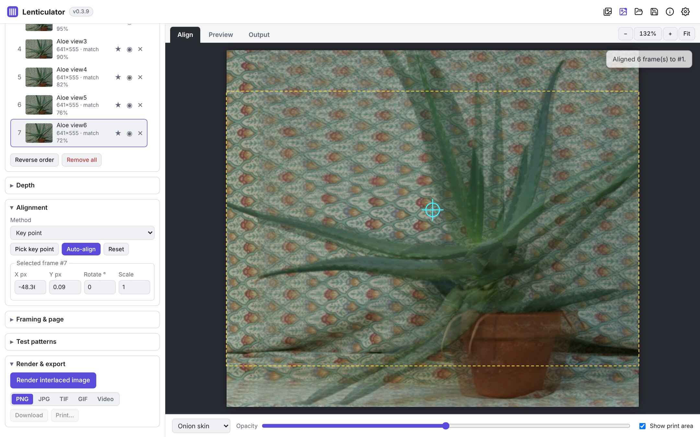
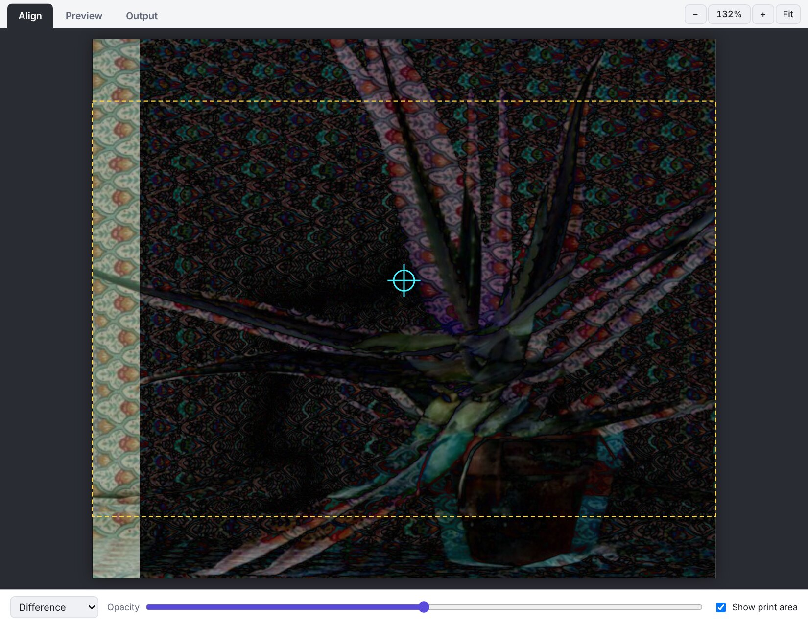

# Alignment

Frames shot by hand, by different cameras or with a sliding camera rarely line up exactly. Lenticulator aligns every frame to the **reference frame** (★ in the frame list).

## Methods

| Method | Use for | What it does |
|---|---|---|
| **Shift + rotate + scale** | Hand-held shots, scans | Finds the shift, small rotation and zoom difference of each frame. Sub-pixel accurate. |
| **Shift only** | Tripod shots, animation | Finds the shift only. |
| **Key point** | 3D | Lines every frame up on one subject. |

Click **Auto-align** to run the selected method. **Reset** clears the alignment of all frames.

## Key point (3D)

In a 3D sequence, near and far objects shift by different amounts between frames, so no single shift lines up the whole picture. You choose what lines up:

1. Click **Pick key point**. The Align tab opens.
2. Click the subject that should sit **at the print surface**, usually something in the middle distance with clear detail.
3. Click **Auto-align**.

The key point stays fixed; nearer things float in front of the print and farther things sit behind it. To choose a different point, click **Pick key point** again.

## Manual adjustment

Select a frame in the list, then:

- **Drag** the image in the Align tab.
- Use the **arrow keys** (Shift = ×10, Alt = ×0.1).
- Type **X px**, **Y px**, **Rotate °** and **Scale** in the panel.
- Press **[** and **]** to step to the previous and next frame.

## Overlays

The overlay dropdown below the Align view compares the selected frame with the reference:

| Overlay | Shows |
|---|---|
| **Onion skin** | The selected frame over the reference, at the chosen opacity. |
| **Difference** | Black where the frames match; bright edges where they don't. |
| **Flicker** | Switches between the two frames. |
| **Selected only** | Just the selected frame. |
| **Anaglyph** | Reference in red, selected frame in cyan (red/cyan glasses). |

**Show print area** outlines the part of the image that will be printed (yellow dashed line) and dims everything outside it. The same overlays are available in the Preview tab: see [Preview and Export](Preview-and-Export).
