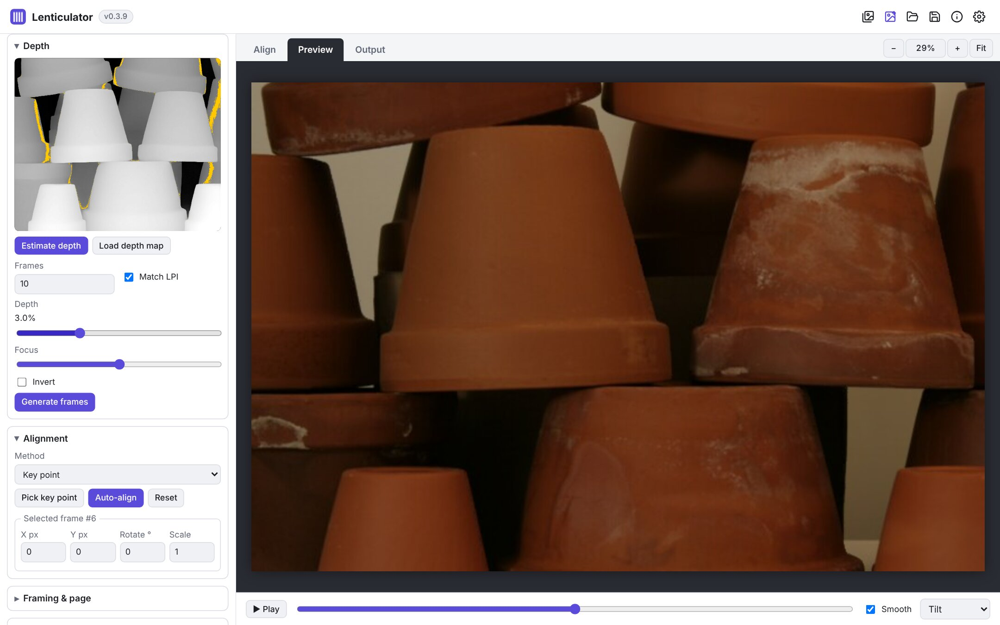

# Depth from a Photo

Make a 3D print from **a single photo**. Lenticulator estimates how far away each part of the picture is, then generates the views a sliding camera would have taken.

The **Depth** panel appears in **3D** mode.

## Steps

1. Import a photo and select it in the frame list.
2. Click **Estimate depth**. If the photo is an iPhone portrait-mode photo (JPEG or HEIC), its own depth map is used straight away; otherwise the depth is estimated. The depth map appears in the panel: white is near, black is far. Alternatively click **Load depth map** to use your own (for example from a phone's portrait mode); tick **Invert** if white means far in your map.
3. Adjust:
   - **Frames**: how many views to generate. With **Match LPI** ticked, this is DPI ÷ LPI, one view per printed dot under each lens.
   - **Depth**: the strength of the effect, as total parallax in percent of the image width (default 2.5%). A lens shows about one lens pitch of parallax per frame cleanly (frames ÷ LPI inches in total); above that the panel shows **⚠ max …%** and the print will look blurred or doubled.
   - **Focus**: which depth sits at the print surface. It shows as a **yellow line** on the depth map. Nearer things float in front, farther things sit behind.
4. Click **Generate frames**. The frame list is replaced by the generated views; the middle view becomes the reference. You can change the settings and generate again.

## About the depth model

Depth is estimated with **Depth Anything V2 Small** (Apache-2.0), running entirely on your device with ONNX Runtime (WebAssembly). The model (about 27 MB) ships with the app and loads the first time you click **Estimate depth**; it works offline. Estimation takes a few seconds.

## Tips

- Photos with a clear subject and a separate background work best.
- Strong **Depth** settings show more smearing at the edges of near objects, where background that was hidden has to be filled in.
- Generated views are already aligned; no auto-alignment is needed.
