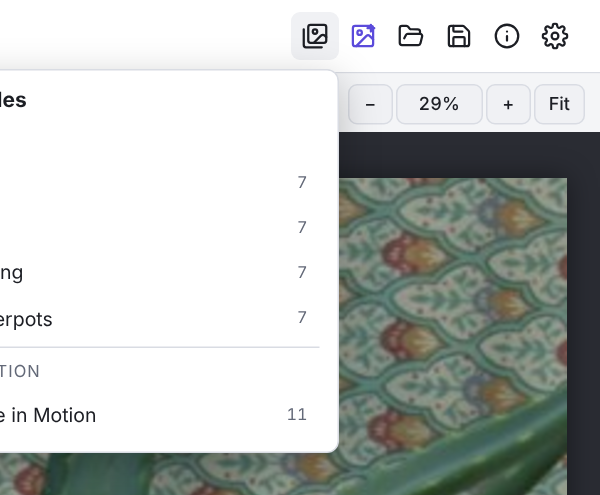

# Getting Started

## Install

**Web version**: build it once and host the `dist/` folder anywhere, or run it locally:

```bash
npm install
npm run dev
```

**Desktop app**: installers for Windows (`.exe`), macOS (`.dmg`) and Linux (AppImage, `.deb`) are attached to [GitHub releases](https://github.com/AbstractPolygon/Lenticulator/releases) when a version is tagged. To build them yourself:

```bash
npm run dist:win
```
```bash
npm run dist:mac
```
```bash
npm run dist:linux
```

## Your first print

1. **Choose the effect** at the top of the left panel: **3D** or **Animation**. 3D uses vertical lenses and key-point alignment; Animation uses horizontal lenses and shift-only alignment.
2. **Add frames.** Drag images or a whole folder onto the window, click the import button, or pick a set from the **Samples** menu. See [Importing Frames](Importing-Frames).
3. **Set up the print.** Choose the size, your printer's **DPI** and your lens **LPI**. See [Print and Lens Settings](Print-and-Lens-Settings).
4. **Align the frames.** Click **Auto-align**. For 3D, click **Pick key point** first and click the subject that should sit at the print surface. See [Alignment](Alignment).
5. **Check the preview.** Move the mouse across the **Preview** tab to simulate tilting the print.
6. **Render and export.** Click **Render interlaced image**, choose PNG, JPG or TIF, then **Download** or **Print…**. See [Preview and Export](Preview-and-Export).



> **Tip:** before your first real print, print a [pitch test](Test-Patterns) to find your lens's true LPI. The nominal value printed on the lens packaging is rarely exact at your viewing distance.

## Printing tips

- Print at **100% / actual size**, with "fit to page", scaling and borderless expansion turned off.
- Use your printer's native resolution as DPI (often 600/1200 for Canon and HP, 720/1440 for Epson).
- Keep the number of frames at or below DPI ÷ LPI; the info box under the lens settings warns you when you go over.
- Lay the lens on the print and rotate it until the [lens alignment bars](Print-and-Lens-Settings#margins-alignment-bars-and-crop-marks) look uniform, then fix it in place.
