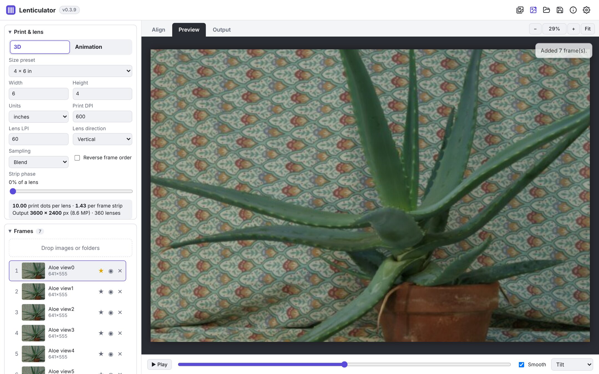

# Lenticulator

Lenticulator turns a set of images into an **interlaced print for lenticular lenses**, for 3D (depth) or animation/flip effects. It runs in a web browser and as a desktop app for Windows, macOS and Linux. All processing happens on your computer; images are never uploaded.

**[Website and downloads](https://abstractpolygon.github.io/Lenticulator/)** · **[Open the app in your browser](https://abstractpolygon.github.io/Lenticulator/app/)**

## Pages

- [Getting Started](Getting-Started): install, first print, the main workflow
- [Importing Frames](Importing-Frames): formats, folders, MPO, HEIC, TIFF, PSD, samples
- [Alignment](Alignment): auto-align, key point, manual adjustment, overlays
- [Depth from a Photo](Depth-from-a-Photo): make a 3D print from a single photo
- [Print and Lens Settings](Print-and-Lens-Settings): size, DPI, LPI, lens direction, framing, margins
- [Test Patterns](Test-Patterns): pitch test, lens ruler, frame order test
- [Preview and Export](Preview-and-Export): tilt preview, overlays, zoom, PNG/JPG/TIFF/GIF/video, printing
- [Settings and Projects](Settings-and-Projects): themes, panel location, import options, projects, keyboard shortcuts
- [Licenses](Licenses): app, model and library licenses
- [About](About): who makes Lenticulator, credits and sample image sources

## Key terms

| Term | Meaning |
|---|---|
| **LPI** | Lenses per inch of the lenticular sheet. |
| **DPI** | The printer's dots per inch. |
| **Dots per lens** | DPI ÷ LPI: how many printed dots sit under each lens. This is the maximum useful number of frames. |
| **Frame** | One of the images that is interlaced: a view (3D) or a moment (animation). |
| **Interlacing** | Cutting every frame into thin strips and placing one strip of each under every lens. |
