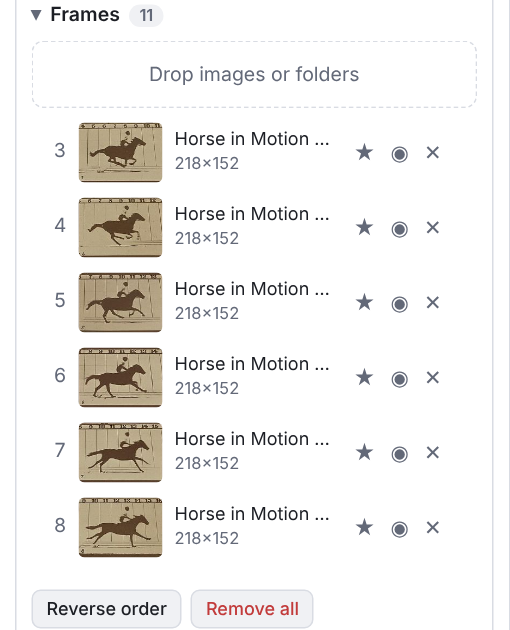

# Importing Frames

## Ways to add frames

- **Drag and drop** images or **whole folders** (subfolders included) anywhere on the window. Files are sorted by name, numerically (`frame2` comes before `frame10`). Hidden files and non-images are skipped.
- **Import button** (top bar): choose one or more files.
- **Samples menu** (top bar, left of Import): load a ready-made set with one click. Loading a sample replaces the current frames and switches to its effect.

## Supported formats

| Format | Notes |
|---|---|
| JPEG, PNG, WebP, GIF, BMP, AVIF, SVG, ICO | Decoded by the browser. GIF imports its first frame. |
| **MPO / JPS** | Stereo files from 3D cameras (e.g. Fujifilm FinePix REAL 3D W1/W3, Nintendo 3DS). Split into left and right frames automatically. |
| **HEIC / HEIF** | iPhone photos. Opened natively in Safari, otherwise with a bundled decoder. |
| **TIFF** | 8- and 16-bit. Each page of a multi-page TIFF becomes a frame (configurable). |
| **PSD / PSB** | Photoshop files: the flattened image, or one frame per layer (configurable). |

The HEIC, TIFF and PSD decoders load only the first time you open such a file.

Import options are under **Settings → Import**: see [Settings and Projects](Settings-and-Projects).

## The frame list

- **Drag** a frame to reorder it. **Reverse order** flips the whole list.
- **★** makes a frame the **alignment reference**; the others are aligned to it.
- **◉ / ○** includes or excludes a frame from the print without removing it.
- **✕** removes the frame. **Remove all** clears the list (click twice).
- After auto-alignment each frame shows a **match** percentage.

## Sample sets

| Set | Effect | Source |
|---|---|---|
| Aloe, Art, Baby, Bowling, Dolls, Flowerpots, Moebius, Reindeer | 3D, 7 views each | [Middlebury 2005 and 2006 stereo datasets](https://vision.middlebury.edu/stereo/data/) |
| Earth | Animation, 10 frames | NASA [EPIC](https://epic.gsfc.nasa.gov/) camera on DSCOVR |
| Elephant, Cat, Elk, Camel, Raccoon | Animation, 6–10 frames | Eadweard Muybridge, *Animal Locomotion* (1887), [Wellcome Collection](https://wellcomecollection.org/) |
| Horse | Animation, 11 frames | Eadweard Muybridge (1878), [Library of Congress](https://www.loc.gov/item/97502309/) |

In the desktop app the samples are an optional download: tick **Settings → Samples → Sample images**. The Samples button appears once they're installed.
