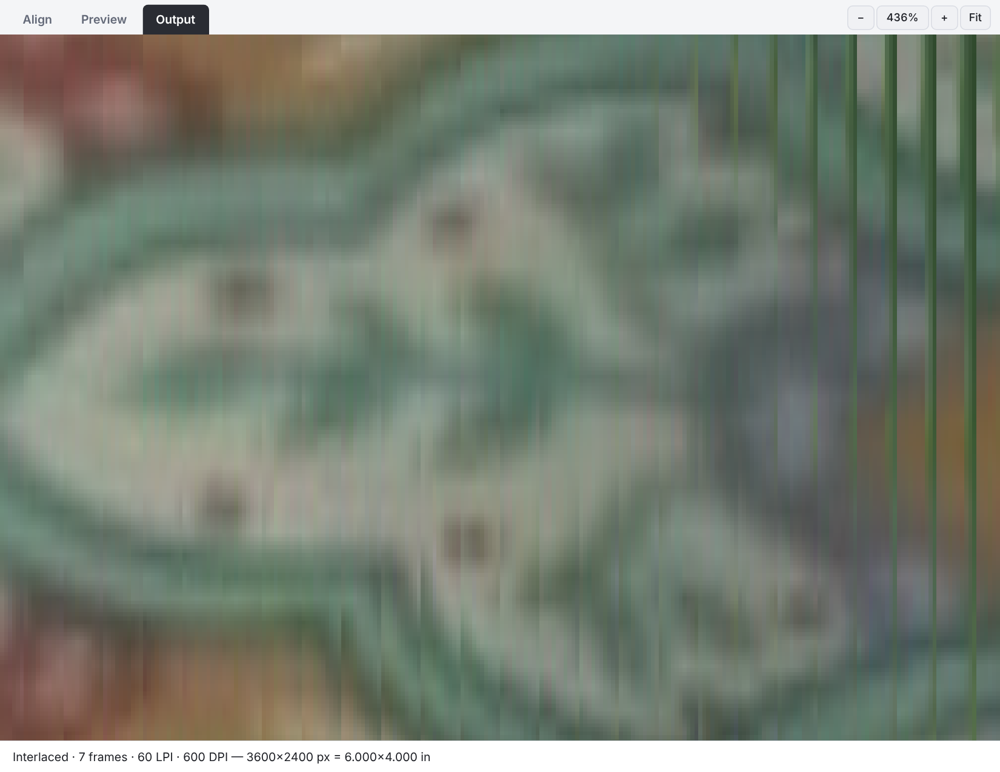
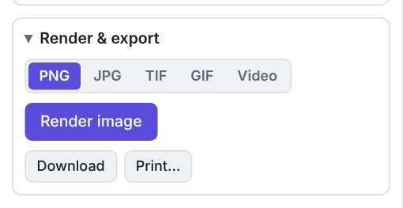

# Preview and Export

## Preview

The **Preview** tab simulates tilting the finished print.

- Move the mouse across the preview, drag the slider, or press **Play**.
- **Smooth** blends between neighbouring frames.
- The mode dropdown switches between **Tilt** and the comparison overlays **Onion skin**, **Difference** and **Flicker** (current view versus the reference frame). **Anaglyph** (3D only) shows two views in red/cyan for viewing with 3D glasses.

## Zoom and pan

Zoom works the same in Align, Preview and Output; each tab keeps its own zoom.

| Action | How |
|---|---|
| Zoom in/out | **−** / **+** buttons in the tab row, mouse wheel or trackpad pinch (zooms around the cursor), or keys **+** / **−** |
| Fit | **Fit** button or key **0** |
| 100% (1 image pixel = 1 screen pixel) | Click the percentage or key **1** |
| Pan | Drag when zoomed in, middle-drag, or hold **Space** and drag |

The Output tab zooms up to 3200% so you can inspect individual print dots.

## Render and export

1. Choose a format, then click **Render image** to interlace the frames at full print resolution. The result appears in the **Output** tab.
2. Click **Download**.

| Format | Contents |
|---|---|
| **PNG** | Rendered print, lossless, tagged with the print DPI. |
| **JPG** | Rendered print, tagged with the print DPI. |
| **TIF** | Rendered print, uncompressed, tagged with the print DPI. |
| **GIF** | Animated GIF of the aligned frames, one GIF frame per frame, 10 per second (no render needed). Animations loop forward; 3D views rock back and forth. |
| **Video** | MP4 (or WebM where MP4 isn't available) of the tilt preview (no render needed). |

**Print…** prints at the exact physical size. Turn off printer scaling and borderless expansion.

