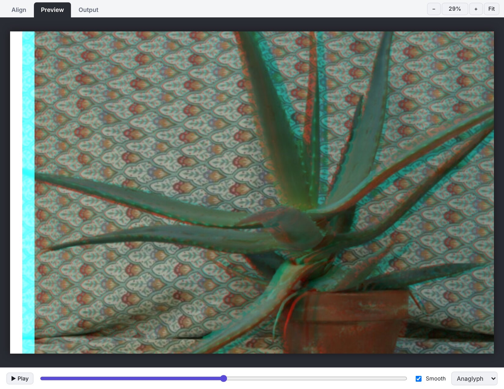
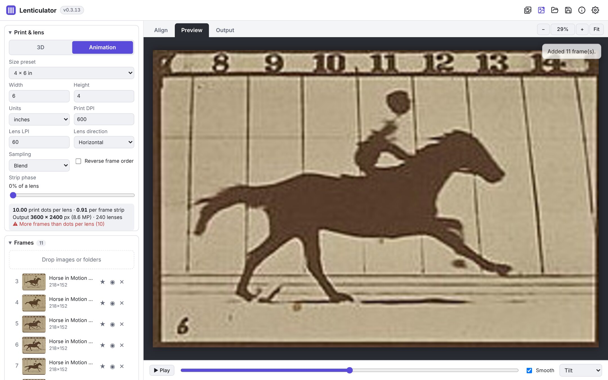
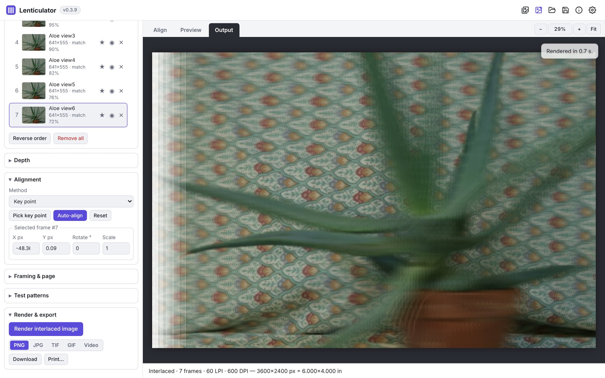

# Preview and Export

## Preview

The **Preview** tab simulates tilting the finished print.

- Click or drag across the preview, drag the playhead, or press **Play**.
- **Smooth** blends between neighbouring frames (off by default).
- The mode dropdown switches between **Tilt** and the comparison overlays **Onion skin**, **Difference** and **Flicker** (current view versus the reference frame). **Anaglyph** (3D only) shows two views in red/cyan for viewing with 3D glasses.

## Zoom and pan

Zoom works the same in Align, Preview and Output; each tab keeps its own zoom.

| Action | How |
|---|---|
| Zoom in/out | **−** / **+** buttons in the tab row, mouse wheel or trackpad pinch (zooms around the cursor), or keys **+** / **−** |
| Fit | **Fit** button or key **0** |
| 100% (1 image pixel = 1 screen pixel) | Click the percentage or key **1** |
| Pan | Drag when zoomed in, middle-drag, or hold **Space** and drag |

The Output tab zooms up to 3200% so you can inspect individual print dots.

## Render and export

1. Choose a format, then click **Render** to interlace the frames at full print resolution. The result appears in the **Output** tab. For **GIF** and **Video**, **Render** makes the animation instead and plays it in the *Output* tab; **Download** saves it. **Download** (and **Print…**, for PNG/JPG/TIF) appears once something has been rendered.
2. Click **Download**.

| Format | Contents |
|---|---|
| **PNG** | Rendered print, lossless, tagged with the print DPI. |
| **JPG** | Rendered print, tagged with the print DPI. |
| **TIF** | Rendered print, uncompressed, tagged with the print DPI. |
| **GIF** | Animated GIF of the aligned frames, one GIF frame per frame (no render needed). Set the speed in frames per second (1–50, default 10) and the dithering (none, Floyd–Steinberg, Atkinson or ordered) next to the format buttons. Dithering smooths gradients in the GIF's 256 colours; ordered gives a regular, retro pattern. Animations loop forward; 3D views rock back and forth. |
| **Video** | MP4 (or WebM where MP4 isn't available) of the tilt preview (no render needed). Set how many times it tilts back and forth (1–20 loops, default 2) next to the format buttons. |

**Print…** prints at the exact physical size. Turn off printer scaling and borderless expansion.

