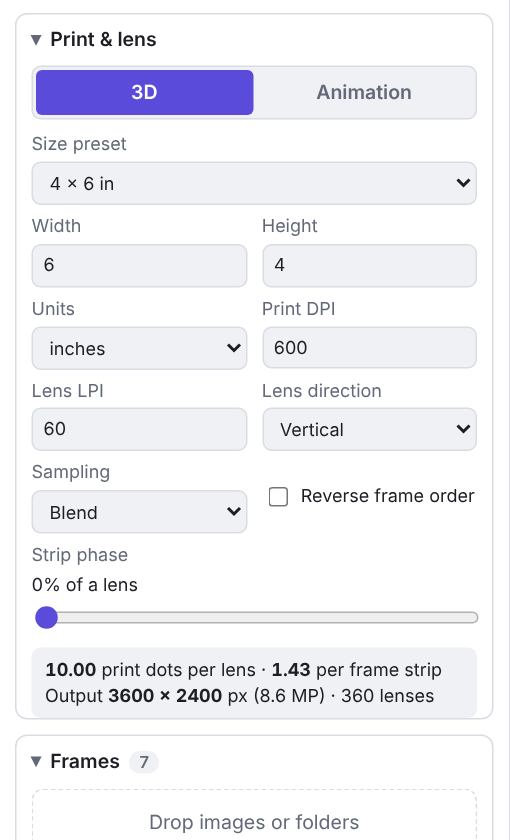

# Print and Lens Settings

## Effect

**3D** or **Animation** at the top of the panel. Switching sets sensible defaults:

| Effect | Lens direction | Alignment |
|---|---|---|
| 3D | Vertical (each eye sees a different view) | Key point |
| Animation | Horizontal (both eyes see the same frame, no ghosting) | Shift only |

## Size, DPI and LPI

| Setting | Meaning |
|---|---|
| **Size preset**, **Width**, **Height**, **Units** | Print size without margins, in inches or mm. Print presets keep the current portrait/landscape orientation. **Social** presets (Instagram, Story/Reel/TikTok, YouTube, X, Facebook/LinkedIn, Pinterest) set exactly that many pixels at the current DPI and keep them when the DPI changes; GIF and video exports use the same pixel size. |
| **Print DPI** | Your printer's resolution. Use its native resolution (e.g. 600/1200 Canon/HP, 720/1440 Epson). |
| **Printer**, **Lens sheet** | Presets that set Print DPI, by printer grouped by brand (Brother, Canon, Epson and HP series and the best-selling models; Canon PIXMA, PIXMA PRO-200 / PRO-100, imagePROGRAF PRO-300, SELPHY; Epson EcoTank Photo, Expression Photo, Stylus Photo, SureColor P700 / P900; HP ENVY / Smart Tank) or by resolution (300, 360, 600, 720, 1200, 1440, 2400, 2880), and Lens LPI (10–161) by name. They show *Custom* when you type your own values, e.g. the LPI found with the pitch test. |
| **Lens LPI** | Lenses per inch. Fractional values are allowed; use the value found with the [pitch test](Test-Patterns). |
| **Lens direction** | **Vertical**: tilt left/right (needed for 3D). **Horizontal**: tilt up/down. |
| **Sampling** | **Blend**: anti-aliased strips, exact for any DPI/LPI. **Nearest**: crisp strips of whole printer dots. |
| **Reverse frame order** | Tick if the print moves the wrong way when tilted. |
| **Strip phase** | Shifts the strips under the lenses; changes which frame is seen head-on. |

The info box shows dots per lens, dots per frame strip, the output size in pixels and the number of lenses. It warns when there are more frames than dots per lens, when the lens direction doesn't suit the effect, and when the output is very large.

## Framing and page

| Setting | Meaning |
|---|---|
| **Fit** | **Fill** crops the image to fill the print; **Fit** shows the whole image with borders. |
| **Background** | Colour used where an image doesn't cover the print. |
| **Zoom**, **Pan X**, **Pan Y** | Enlarge and move the image within the print area. |
| **Margin** | White border around the image. |

### Margins, alignment bars and crop marks

With a margin set:

- **Lens alignment bars** print strips in the margin at the lens pitch, in phase with the image. Lay the lens on the print and rotate it until the bars look uniform along their whole length, then fix it in place.
- **Crop marks** show where to cut.
