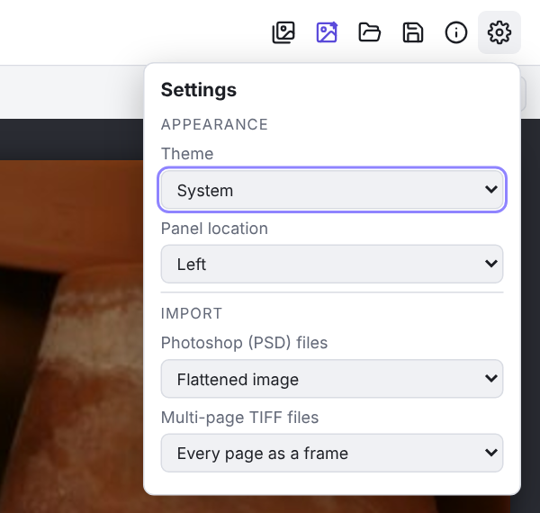
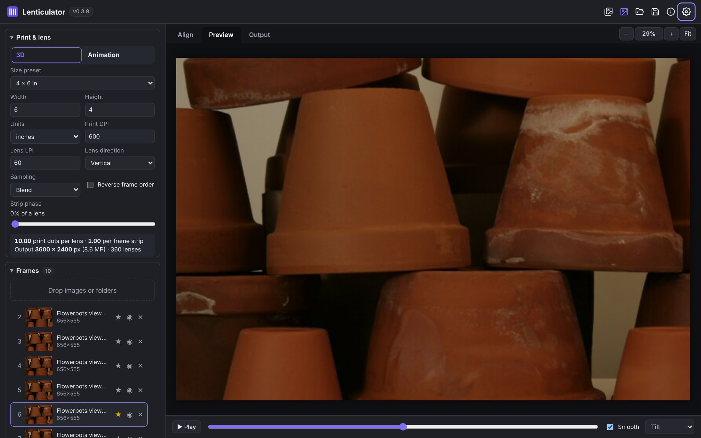
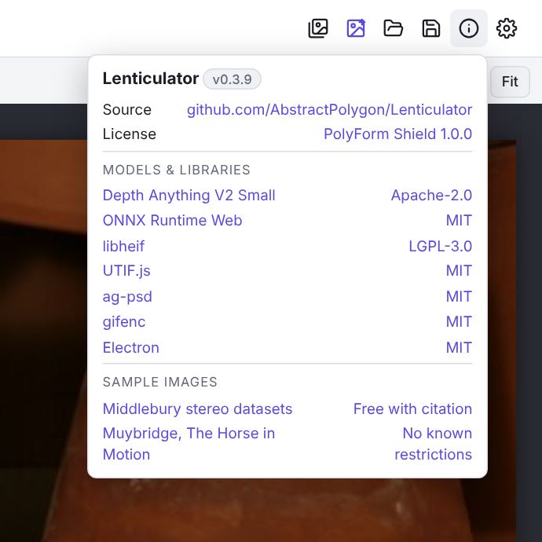

# Settings and Projects

## Top bar

From left to right: **Samples**, **Import**, **Open project**, **Save project**, **About**, **Settings**. Hover any control for a tooltip.

## Settings

| Setting | Options |
|---|---|
| **Theme** | System (follows your OS light/dark setting), Light, Dark, High contrast |
| **Rendering** | Auto (graphics card when available, otherwise the CPU), GPU, or CPU |
| **Panel location** | Control panel on the left or right |
| **Photoshop (PSD) files** | Flattened image, or each layer as a frame (bottom layer first) |
| **Multi-page TIFF files** | Every page as a frame, or first page only |

Theme, rendering and panel location are remembered per device.

## Projects

**Save project** writes a single `project.lenti.json` file with all frames (original image data), alignment, the reference frame, the key point and all print settings. **Open project** restores it.

## About

The About panel shows the version, a link to the source code, and the licenses of the app, the depth model, the libraries and the sample images.

## Keyboard shortcuts

| Keys | Action |
|---|---|
| Arrow keys | Nudge the selected frame (Align tab); Shift = ×10, Alt = ×0.1 |
| **[** / **]** | Previous / next frame (Align tab) |
| **+** / **−** | Zoom in / out |
| **0** | Fit |
| **1** | 100% |
| Space + drag | Pan |
| Esc | Close a menu |
