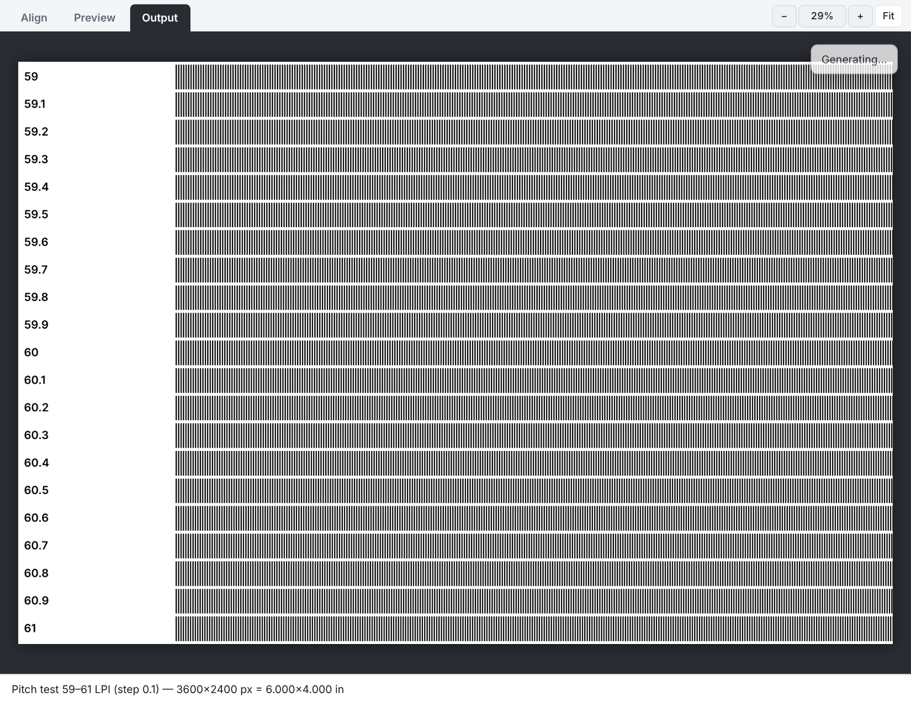
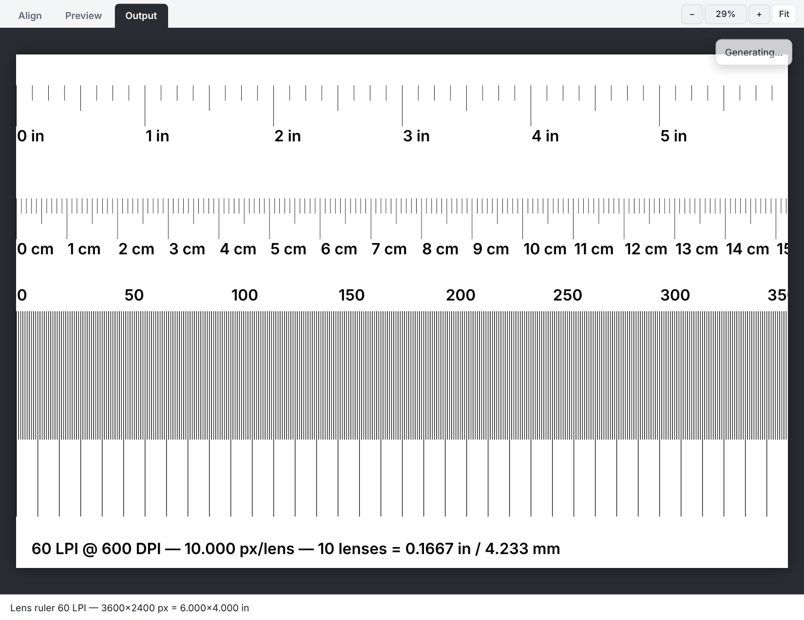
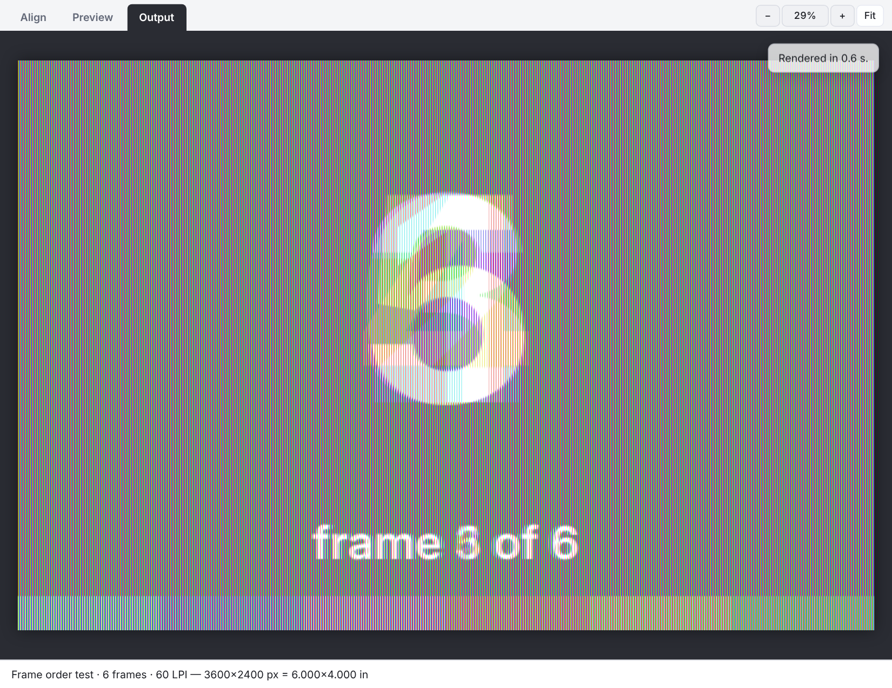

# Test Patterns

Test patterns are generated at the current size, DPI and LPI. Open **Test patterns** in the left panel, choose a pattern and click **Generate test pattern**. The result appears in the Output tab and can be downloaded or printed like any render.

## Pitch test

Finds your lens's **true LPI** at your viewing distance, which is rarely exactly the nominal value.

Each band is interlaced black/white at a slightly different LPI (set the **± range** and **Step**).

1. Print it at 100%.
2. Lay the lens on top with the lenses parallel to the lines.
3. View from your normal distance and tilt slowly.
4. The band that flips cleanly between solid black and solid white, with no stripes, is your true LPI. Enter it as **Lens LPI**.

## Lens ruler

Checks that your printer isn't scaling the print, and helps line up the lens.

It prints inch and centimetre scales and one line per lens, with a long line every 10 lenses. Measure the scales with a real ruler; 10 lenses should span exactly 10 ÷ LPI inches.

## Frame order test

Shows tilt direction and which frame faces you head-on.

Each frame is a numbered colour. Tilting should step through 1, 2, 3… in order. If it runs backwards, tick **Reverse frame order**; use **Strip phase** to move the middle frames to the head-on position.
